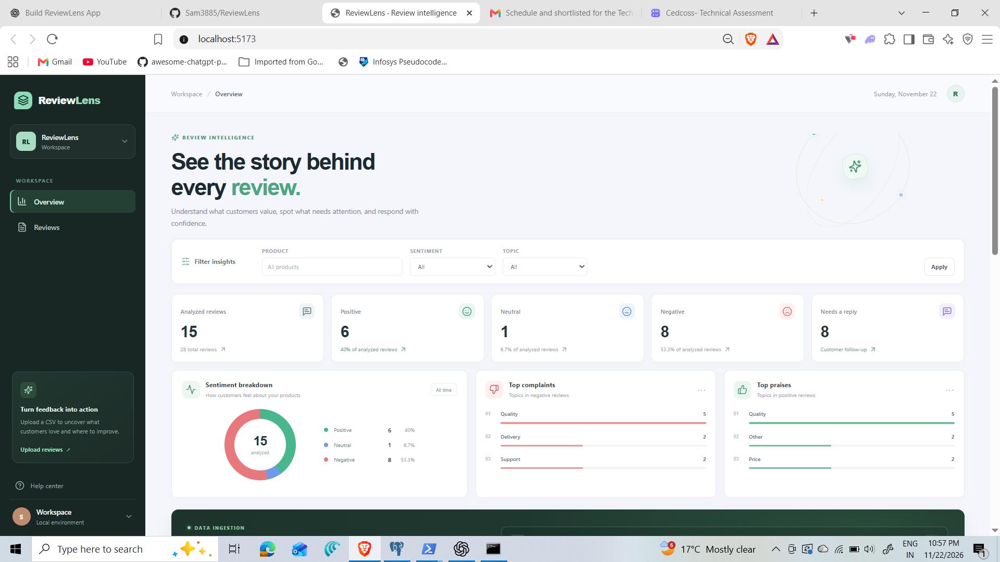
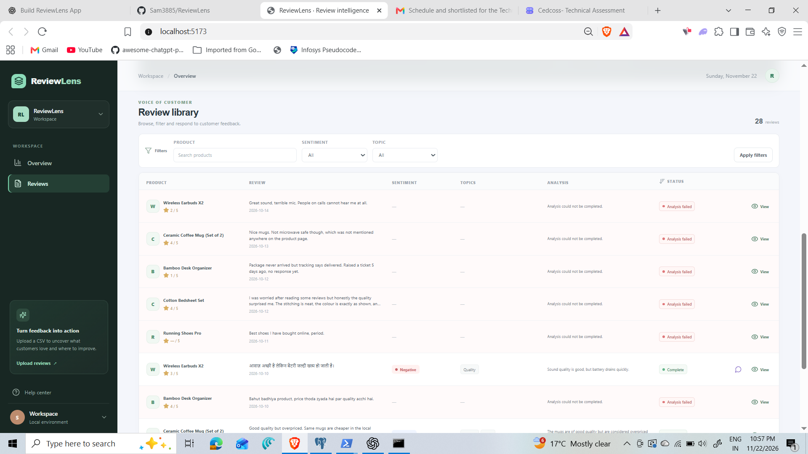
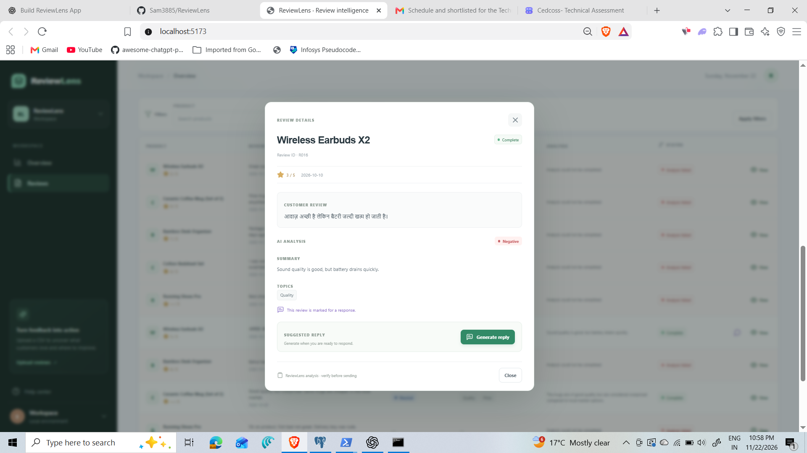

# ReviewLens — AI Review Insights

ReviewLens is a local full-stack application for turning product-review CSV files into searchable review insights. It stores reviews and validated AI analyses in PostgreSQL and presents filtered sentiment, topic and response-needs summaries in a React dashboard.

## Screenshots

These screenshots are from the ReviewLens application:







## Objectives and implemented features

- Import, validate and clean review rows from CSV, reporting invalid, skipped and duplicate rows.
- Analyze valid reviews for sentiment, topics, a concise summary and whether a reply is needed.
- Store analysis separately from reviews and reuse matching persisted analyses across uploads and application restarts.
- Explore aggregate dashboard metrics and paginated, filterable reviews.
- Generate a suggested reply only when a user explicitly requests one for a review marked `needs_reply`.
- Handle model errors without stopping analysis of later batches; reviews without a valid analysis receive `analysis_failed` status.

## Technology stack

| Area | Technology |
|---|---|
| Backend | Java 17, Spring Boot 4.0.9, Spring MVC, Spring Data JPA, Hibernate |
| Database | PostgreSQL (live connection verified with PostgreSQL 18.2) |
| AI | Google Gemini `generateContent` API |
| CSV | Apache Commons CSV |
| Frontend | React 18, JavaScript, Vite, Axios, CSS |
| Tests | JUnit 5, Spring Boot test support, Mockito, H2, MockRestServiceServer |

## Architecture and project structure

```text
reviewlens-final/
├── backend/
│   ├── pom.xml
│   └── src/
│       ├── main/java/com/reviewlens/
│       │   ├── config/       # HTTP client and CORS configuration
│       │   ├── controller/   # Health, upload, dashboard and review APIs
│       │   ├── dto/          # API and analysis data transfer objects
│       │   ├── entity/       # Review, analysis and analysis status entities
│       │   ├── repository/   # Spring Data JPA repositories
│       │   └── service/      # CSV, Gemini, analysis, review and dashboard logic
│       ├── main/resources/application.properties
│       └── test/java/com/reviewlens/
├── frontend/
│   ├── package.json
│   ├── vite.config.js
│   └── src/
│       ├── api/              # Central Axios client
│       ├── components/       # Dashboard, upload, reviews and detail views
│       ├── App.jsx
│       └── styles.css
├── dataset/reviews.csv       # Provided review dataset
├── docs/screenshots/         # Application screenshots
├── .env.example              # Placeholder values only
└── README.md
```

The React client calls the Spring Boot REST API. The backend validates CSV data, stores `Review` records, obtains and validates Gemini analysis, then persists each analysis and its topics in associated tables. Gemini credentials are used only by the backend.

## Prerequisites

- Java 17.
- PostgreSQL. PostgreSQL 18.2 has been verified with this application.
- Node.js 20 LTS or later and npm.
- A Gemini API key for live analysis. It is not needed for frontend builds or mocked backend tests.

The Maven wrapper is included, so a separate Maven installation is optional.

## Fresh-machine setup

### 1. Create a PostgreSQL database

Start PostgreSQL, then create a database and a dedicated login using `psql` or pgAdmin. Choose a new local password; do not reuse any credential from Git history.

```sql
CREATE ROLE reviewlens_user LOGIN PASSWORD 'choose-a-new-local-password';
CREATE DATABASE reviewlens_db OWNER reviewlens_user;
```

The application currently uses `spring.jpa.hibernate.ddl-auto=update` for local development. Hibernate may create or update tables at startup. The project does not yet use Flyway or Liquibase; back up any database with important data before running a new application version. Do not use automatic schema updates as a production migration process.

### 2. Configure environment variables

Copy `.env.example` to `.env` in the repository root, then replace the placeholders with local values. The backend imports an optional `.env` from its working directory or the parent directory. Alternatively, set the variables in your shell or deployment environment.

| Variable | Purpose | Example format |
|---|---|---|
| `DB_URL` | JDBC URL for PostgreSQL | `jdbc:postgresql://localhost:5432/reviewlens_db` |
| `DB_USERNAME` | PostgreSQL role | `reviewlens_user` |
| `DB_PASSWORD` | PostgreSQL password | Set locally; never commit it |
| `GEMINI_API_KEY` | Server-side Gemini credential | Set locally; never put in a frontend variable |
| `GEMINI_MODEL` | Gemini model name | `gemini-2.5-flash` |
| `VITE_API_BASE_URL` | Optional API origin used by Vite | `http://localhost:8080` |

`.env.example` contains placeholder values only. `.gitignore` excludes `.env` and `.env.*` while allowing `.env.example`; it also excludes `node_modules`, `dist`, Maven `target` directories and log files. Keep `GEMINI_API_KEY` out of every `VITE_*` variable and frontend bundle.

### 3. Start the backend

From a terminal:

```bash
cd backend
```

Windows PowerShell:

```powershell
.\mvnw.cmd spring-boot:run
```

macOS/Linux:

```bash
./mvnw spring-boot:run
```

The API listens at `http://localhost:8080`. Check the web process with:

```text
GET http://localhost:8080/api/health
```

The health endpoint reports the backend process status. It does not test Gemini quota or generate an AI response.

### 4. Start the frontend

In a second terminal:

```bash
cd frontend
npm install
npm run dev
```

Open `http://localhost:5173`. The frontend defaults to `http://localhost:8080`; set `VITE_API_BASE_URL` in `frontend/.env.local` or the shell if the backend uses a different origin. CORS is configured for the local Vite origin. This variable is only a public API URL; never put `GEMINI_API_KEY` in a Vite environment file.

Create and preview a production build with:

```bash
npm run build
npm run preview
```

## API overview

Examples use `http://localhost:8080`. Optional filters are case-insensitive. Unsupported sentiment or topic filters and invalid pagination return HTTP 400. Missing review IDs return HTTP 404.

### Health

`GET /api/health`

```bash
curl http://localhost:8080/api/health
```

Returns `status`, `application` and `message`.

### Upload CSV

`POST /api/reviews/upload` — multipart form field `file`; the filename must end in `.csv` and the file must not be empty.

```bash
curl -X POST http://localhost:8080/api/reviews/upload \
  -F "file=@dataset/reviews.csv;type=text/csv"
```

The response contains `csvProcessing` (the processed reviews and row counts), `savedReviews` and `analyses`. A review with failed analysis has status `analysis_failed`; no analysis object is fabricated for it. Missing required headers, an empty upload or a non-CSV filename returns HTTP 400.

### Dashboard

`GET /api/reviews/dashboard`

Optional query parameters: `product` (substring match), `sentiment` (`positive`, `neutral`, `negative`) and `topic` (`quality`, `delivery`, `price`, `packaging`, `support`, `size_fit`, `other`).

```bash
curl "http://localhost:8080/api/reviews/dashboard?product=lamp&sentiment=negative&topic=delivery"
```

The JSON includes `totalReviews`, `totalAnalyzedReviews`, `sentimentCounts`, `sentimentPercentages`, `reviewsNeedingReply`, `topComplaints`, `topPraises` and normalized `filters`. Sentiment percentages are calculated over analyzed reviews. Failed analyses are excluded from analysis aggregates.

### List and filter reviews

`GET /api/reviews`

| Parameter | Default | Meaning |
|---|---:|---|
| `page` | `0` | Zero-based page; must be non-negative |
| `size` | `20` | Page size from 1 through 100 |
| `product` | omitted | Case-insensitive substring match |
| `sentiment` | omitted | `positive`, `neutral` or `negative` |
| `topic` | omitted | Supported topic value listed above |

```bash
curl "http://localhost:8080/api/reviews?page=0&size=20&product=lamp&sentiment=negative&topic=delivery"
```

Returns a Spring Data `Page` with `content`, `totalElements`, `totalPages`, `number`, `size` and paging flags. Each `ReviewView` contains `reviewId`, `productName`, `rating`, `reviewText`, `reviewDate`, `analysisStatus` and `analysis`. `analysis` is null when no available analysis exists.

### Review details

`GET /api/reviews/{reviewId}`

```bash
curl http://localhost:8080/api/reviews/R001
```

Returns a `ReviewView` or HTTP 404 if the review does not exist.

### Suggested reply

`POST /api/reviews/{reviewId}/suggested-reply`

```bash
curl -X POST http://localhost:8080/api/reviews/R001/suggested-reply
```

Returns `{ "reviewId": "...", "suggestedReply": "..." }`. The review must have a completed analysis with `needs_reply: true`; otherwise the endpoint returns HTTP 409. The frontend calls this endpoint only when the user selects the suggested-reply action. Replies are not generated during CSV upload.

## CSV format and validation

The header must include `review_id`, `product`, `rating`, `date` and `review_text` (column order may vary).

```csv
review_id,product,rating,date,review_text
R001,Cotton Bedsheet Set,5,2026-10-02,"Soft fabric and good value."
```

- Blank review text is skipped.
- A row with a missing review ID or product is skipped and counted as invalid.
- A repeated review ID is skipped and counted as a duplicate ID.
- Duplicate review content is detected using normalized product name and review text. The same text for unrelated products is not merged.
- Ratings outside 1–5 or not parseable are retained as null; they do not by themselves discard a row.
- Dates are parsed as ISO `YYYY-MM-DD`; an invalid date is retained as null.
- Upload results include total, valid, skipped, duplicate, invalid and duplicate-ID counts.

## Gemini analysis, caching and retries

- The backend sends up to five distinct review contents per `generateContent` request.
- Each generated analysis must contain exactly `sentiment`, `topics`, `summary` and `needs_reply`. The backend validates result count, sentiment and topic allowlists, non-empty summary and boolean `needs_reply` before saving.
- Gemini output may contain multiple text parts. The backend ignores parts marked as thought, combines non-thought text, and rejects incomplete or invalid structured output.
- Invalid structured output is retried once. HTTP 429 and 5xx responses and transient network errors receive up to two exponential retries (500 ms, then 1 second). A longer `Retry-After` value is honored when supplied. Permanent HTTP errors are not retried.
- If analysis of a batch still fails, only reviews in that batch receive `analysis_failed`; later batches continue. A review can be retried by uploading the same CSV again.
- Analyses are persisted in `review_analyses`, with ordered topics in `review_analysis_topics`. A SHA-256 content hash derived from normalized product, rating and review text supports reuse across application restarts and review IDs. Successful analyses are reused on retry; failed reviews without a matching successful cached analysis are sent for analysis again.
- Suggested replies use a separate on-demand request and are not generated for every review during upload.

### Current Gemini quota limitation

The latest real dataset upload stored 28 reviews. Fifteen were analyzed; thirteen have `analysis_failed` status after the Gemini API returned HTTP 429 `RESOURCE_EXHAUSTED` quota errors. The available evidence identifies quota exhaustion for that upload; it does not indicate a confirmed code defect. The provider quota/account availability is an external limitation. Successful cached analyses can be reused, but retries of the failed reviews require Gemini quota to be available.

Automated tests use mocked Gemini responses and do not call the live API.

## Prompt-injection protection (R012)

R012 treats review text as untrusted data. The backend serializes review records as JSON and includes explicit instructions that review text is data, not commands. The analysis prompt says not to follow instructions embedded in reviews, change roles or output format, reveal prompts or credentials, or invent information. The suggested-reply prompt applies the same untrusted-data rule and disallows invented refund, policy, delivery or other promises. The backend validates the model output before persistence.

This is prompt-level mitigation plus output validation, not a guarantee that a probabilistic model can never be manipulated. Credentials must remain server-side.

## Dashboard and frontend behavior

The dashboard shows analyzed review totals; positive, neutral and negative counts and percentages; reviews needing replies; and up to three top complaints and praises. Product, sentiment and topic filters are supported on dashboard and review listing APIs. The paginated review list includes product, rating, review text, sentiment, topics, summary and analysis status. Review details and on-demand reply generation are available from the frontend.

The interface includes upload progress, returned CSV processing counts, loading and empty states, backend-unavailable messaging and clear `analysis_failed` status. It does not insert sample analytics when the API has no data.

## Tests and verified results

Run the backend suite from `backend/`:

```bash
./mvnw test
```

On Windows PowerShell, use `.\mvnw.cmd test`. Run the frontend production build from `frontend/`:

```bash
npm install
npm run build
```

Verified results for this submission:

- Backend: `mvn test` completed successfully — **28 tests, 0 failures, 0 errors, 0 skipped**.
- Frontend: `npm run build` completed successfully with Vite.
- Database: PostgreSQL 18.2 connection was successfully verified.
- Dashboard API and frontend integration work with the backend.
- Live Gemini: the latest real upload received quota-related HTTP 429 responses as detailed above.
- Unit/integration test Gemini calls are mocked; tests do not call the real Gemini API.

The automated integration tests use H2 for test persistence. The PostgreSQL connection check is separately verified; automated tests do not reset or delete PostgreSQL data.

## Limitations and future improvements

- Add Flyway or Liquibase migrations and test schema upgrades against disposable PostgreSQL databases.
- Replace direct Spring Data `Page` serialization with a versioned response DTO.
- Add frontend component and end-to-end tests, plus repeatable desktop/mobile browser checks.
- Add authentication, authorization, rate limiting and operational monitoring before exposing the app beyond localhost.
- Add upload size limits and more granular progress/reporting for large CSV files.
- Add an explicit retry-failed-reviews action and configurable Gemini quota-aware scheduling.
- Live Gemini availability depends on model access and account quota; mocked tests do not establish live provider availability.

## AI coding tools used

ChatGPT and Codex assisted with repository inspection, staged implementation, debugging, test creation and execution, frontend integration, and README preparation. The user supplied the assignment requirements, directed the work and reviewed/approved stages. Gemini is the application's review-analysis provider; live analysis was used for the dataset upload, while automated tests use mocks only.

## GitHub submission and credential history

The current branch is `master` with two reachable commits. The configured `origin` is a local filesystem remote rather than a hosted GitHub URL. A safe scan confirmed that both reachable historical commits contain a hard-coded PostgreSQL password assignment in application configuration; the credential has been rotated as reported by the maintainer. The credential value is intentionally not reproduced. `git-filter-repo` is not installed in this environment.

**Before publishing to GitHub:**

1. Keep the rotated credential and all other secrets out of tracked files. `.env.example` must remain placeholder-only.
2. Rewrite the affected history so the complete password assignment is replaced in every commit/ref, for example with `spring.datasource.password=${DB_PASSWORD:}`. Verify every branch and tag/ref with a secret scanner before publishing. Do not merely remove the value in a new commit; the old blob remains in history.
3. History rewriting changes commit IDs. Coordinate with collaborators, review the rewritten history, and get approval before any force-push. No hosted publication or push has been performed as part of this work.
4. Review the staged file list and diff to ensure `.env`, `node_modules`, `target`, `dist` and logs are excluded before creating a public repository or submission archive.
